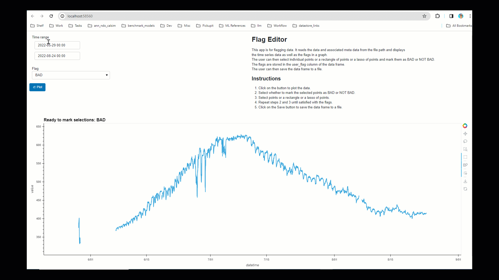
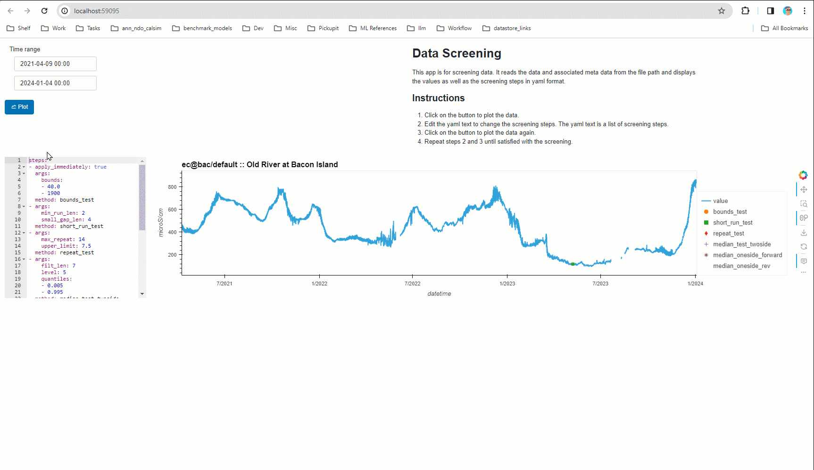

# dms_datastore_ui

Web UI for dms_datastore

Hosted at Azure: https://dwrbdodatastore.azurewebsites.net/

## Server dependencies

`run_server.sh` updates `vtools3` (Python distribution name `vtools`), `dvue`,
and `dms_datastore` from GitHub before starting the app. These installs use
`--no-deps` to preserve the container's scientific Python environment, so
`vtools3` must be updated explicitly alongside `dms_datastore`.

Startup checks that `vtools.functions.error_detect.max_change_test` and
`dms_datastore.auto_screen` import successfully before warming the cache or
launching the server. Installation or import errors stop startup immediately.
An `ImportError` for `max_change_test` indicates an older `vtools3` paired with
a newer `dms_datastore`; deploy the updated startup script and restart the app.


## Cache

The series cache is keyed to a fingerprint of the repository data, so it is
rebuilt only when the data changes. On start, `run_server.sh` reuses the local
cache if it matches, otherwise restores the published snapshot
(`<repo parent>/cache_snapshots/<repo>`), otherwise warms the cache in the
background and publishes a snapshot for later starts. Run
`python repocache.py <repo_dir> --rebuild` to force a full re-warm.
Set `DMS_DATASTORE_UI_CACHE_ROOT` (local) and `DMS_DATASTORE_UI_CACHE_SNAPSHOT_DIR`
(durable) to relocate them. `caching.log` is diagnostic only.

## Command line
```
 dms_datastore_ui -h
Usage: dms_datastore_ui [OPTIONS] COMMAND [ARGS]...

Options:
  -h, --help  Show this message and exit.

Commands:
  data-screener  Show the data screener
  flag-editor    Show the flag editor
  show-repo      Show the station inventory explorer
  version        Print the version of dms_datastore_ui
```

# Data Repository UI

```
 dms_datastore_ui show-repo -h
Usage: dms_datastore_ui show-repo [OPTIONS] REPO_DIR

  Show the station inventory explorer

Options:
  -h, --help  Show this message and exit.
```

[](https://www.youtube.com/watch?v=YlFRzMqWr_M)

# Data Flag Editor
```
dms_datastore_ui flag-editor -h
Usage: dms_datastore_ui flag-editor [OPTIONS] FILEPATH

  Show the flag editor

Options:
  -h, --help  Show this message and exit.
  ```
[](docs/FlagEditorDemo.gif)

# Data Screening Rules Editor
```
dms_datastore_ui data-screener -h
Usage: dms_datastore_ui data-screener [OPTIONS] FILEPATH

  Show the data screener

Options:
  -h, --help  Show this message and exit.
  ```
[](docs/DataScreenerDemo.gif)
